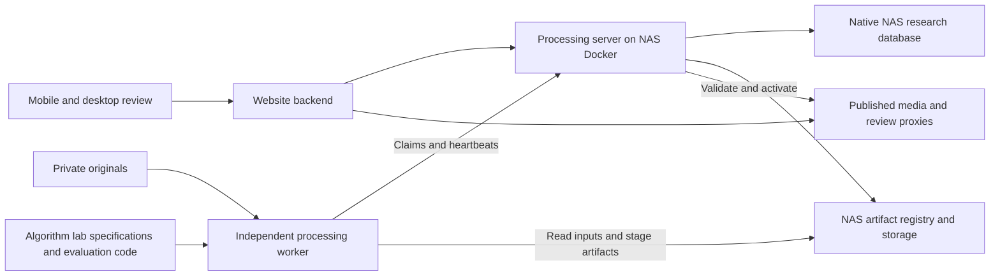

# Tennis feedback and evaluation system design

Design date: 2026-11-02. Status: proposed implementation contract.

Improve tennis cuts through reviewed feedback, reusable observations and repeatable
evaluation. Initial delivery does not require training a model. The NAS coordinates
and stores; independently installed Mac or Windows workers perform computation.

See [Algorithm specification](ALGORITHM-SPEC.md) for formulas, signals and candidate
definitions, and [Milestones](MILESTONES.md) for delivery order and acceptance gates.
All new components below are planned, not implemented.

## Architecture and ownership



| Component | Responsibility |
| --- | --- |
| tennis-web | Feedback/annotation/comparison interface; its DB keeps existing likes, titles and courts |
| tennis-processing-server | Authoritative research records, revisions, datasets, tasks/runs, artifact registry, publication and retention |
| tennis-processing | Installed worker, extraction/inference/rendering adapters, local caches and stage recovery |
| tennis-algorithm-lab | Formulas, annotation/signal/model specifications, candidate recipes, evaluation code and experiment procedure |
| NAS storage | Originals, published media, review proxies, observations/features, predictions and reports |

The website backend calls server APIs. No application opens another application's
DB; no worker credential reaches the browser. Keep the existing LAN-only deployment
and separate native-host SQLite databases. Training and powerful compute stay off
the NAS. Windows remains a portability target until verified on that platform.

Feedback ownership deliberately revises the existing session contract's tentative
placement of future feedback in the website DB. Update that contract in M0. Existing
likes, titles and courts remain unchanged; no implemented feedback needs migration.

## Source and output identities

| Identity | Definition |
| --- | --- |
| source_sha256 | Original byte-content identity, independent of location/name |
| source_id | Existing server registration of a file generation, resolved to verified content hash |
| run_id | Immutable output identity linked to task_id and attempt_id; retries remain distinct attempts |
| output clip reference | run_id plus existing boundary-derived clip_id |
| feedback_id / annotation_id | Independent IDs with retained revisions |
| artifact_id | Registry ID for immutable content, checksum and storage reference |
| practice grouping | Organizational context only; not label ownership |

Two models may produce the same clip ID because boundaries match; the run reference
distinguishes their verdicts. Reprocessing changes cuts without destroying old
feedback. Labels remain attached to the original timeline. Historical feedback may
be shown on overlapping new cuts, clearly identified, but never silently transferred.

Identical source bytes share labels and dataset membership. Re-encoding an original
changes its hash: annotation transfer needs explicit source lineage and a verified
time mapping. Names and recording dates are insufficient. Home-page regrouping
never invalidates labels or changes frozen benchmark splits.

## Time and annotation contracts

Canonical time is integer microseconds relative to normalized original start.
Intervals are `[start_us,end_us)`, with `0 <= start_us < end_us <= duration_us`.
Adapt existing numeric-second contracts explicitly. Source, proxy, individual clip
and joined-video clocks differ. Preserve transforms/sample PTS mappings for
rotation/crop, sampling and export rounding; never equate proxy frame index with
source time or treat concatenated-video time as original time.

Overall feedback contains schema version, ID/revision, source hash, reviewed run
and clip, original interval, tags, optional comment, author reference, timestamps
and review status. Tags include good/poor cut, no tennis play, too short and wrong
player. A vague poor-cut report is a review request, not a negative frame label.
Likes remain separate from cut quality and training evidence.

Boundary feedback independently records start/end too early/late, with optional
corrected source times. Direction-only feedback does not invent exact boundaries.
Edits revise feedback without rewriting published media.

Annotations describe activity separately from desired keep/remove/uncertain edits.
Store source interval, activity, edit preference, optional target track, uncertainty,
annotator kind (human/AI), model/prompt version when relevant, provenance and revision.
Use temporal intervals initially; optional point/frame labels can later identify
stroke peaks, players or keypoints. Lifecycle is proposed, accepted, rejected,
disputed or superseded. Accepted revisions alone become benchmark truth.

Keep independent human/AI judgments; adjudicate conflicts rather than last-write
wins. Without authentication, chosen names or anonymous client IDs are attribution
hints, not verified identity. Mutation APIs require expected_version and idempotency
where appropriate; revisions preserve audit history.

## Review experience

Provide overall feedback beside each clip and a Review cut panel with contextual
playback, current boundaries, draggable handles, playhead-based start/end controls
and fine seeking. Support mobile touch controls and desktop shortcuts. Simple flags
must be possible without manually finding exact corrected boundaries.

Create a lightweight full-source review proxy on demand for a selected recording.
Start playback around the clip and allow expansion or selecting missed play in
removed regions. The proxy exposes the reviewed original's contents, including
removed footage, to the same intentional shared-site audience. It does not mount
private originals in the website. Register it as a temporary allowlisted artifact.
Proxy expiry preserves labels and offers regeneration when dependencies exist.

## Run manifests and artifacts

Every run records task/attempt/source IDs, parent run if any, executor/schema
versions, code revision, model/dependency hashes, preprocessing/feature versions,
effective settings and seeds, input/output references, timing, completion and
publication state. Preserve the actual per-job runtime; a worker's latest heartbeat
advertisement is not the run specification.

Separate observations, activity events/scores and final padded/merged edit intervals.
Store structured reasons such as low visibility, motion threshold passed, padding
added or events merged. Raw rule scores are not calibrated probabilities. Retain
compact final decisions and run history even after dense traces or videos expire.

| Artifact | Storage form |
| --- | --- |
| Proxy metadata | JSON manifest with transform, timing and checksums |
| Pose observations and features | Chunked compressed arrays/columnar files with versioned schema |
| Predictions | Compact JSON intervals plus compressed detailed trace when needed |
| Dataset release | Immutable JSON snapshot of accepted revisions, sources and splits |
| Evaluation | JSON summary, per-source/action tables, optional comparison HTML |
| Model | Manifest with optional immutable weights reference; rules need no weights |

Large payloads use existing `{storage_id,path,sha256,bytes}` file references, never
API JSON. Keep recordings, labels, precise locations, private configuration and
weights outside public Git. Git contains schemas, code and sanitized/synthetic examples.

## Proposed API and executor additions

These are proposed APIs, not existing routes. Retain existing JSON limits,
same-origin mutation checks and worker lease/event/idempotency mechanisms.

| API | Purpose |
| --- | --- |
| GET/POST `/api/v1/feedback` | Query source/run/status or submit feedback |
| PATCH `/api/v1/feedback/{id}` | Revise with expected_version |
| GET/POST `/api/v1/annotations` | Read or propose source labels |
| PATCH `/api/v1/annotations/{id}` | Revise/adjudicate while retaining history |
| POST/GET `/api/v1/datasets` | Freeze/list accepted revisions and session splits |
| GET `/api/v1/datasets/{id}` | Resolve immutable snapshot reference |
| GET `/api/v1/runs` | List outputs for a source, including expired media |
| POST `/api/v1/evaluations` | Schedule pinned candidates against a frozen dataset |
| GET `/api/v1/evaluations/{id}` | Summary and detailed artifact references |
| GET `/api/v1/artifacts/{id}` | Availability, references, size and expiration |
| POST `/api/v1/artifacts/{id}/pin` | Pin/unpin with version/dependency checks |

Retain task types process, dryrun and experiment; add versioned executors for
signal extraction, activity decisions, evaluation and selected review rendering.
Prediction-only experiments register research artifacts without requiring a rendered
session. Dryrun keeps its current no-worker-blob-export-to-NAS semantics: do not
redefine it as analysis-only. A successful experiment does not activate media.

Current server validation only accepts process-v2 and expects a source per task.
Extend capability matching, result schemas and validation explicitly. Dataset
evaluation parents schedule per-source child tasks. Validate exact model/runtime
references per job rather than assuming one model hash globally per worker.

Workers stage on local SSD and advertise supported executors/backends/resources.
Initially allow one heavy job per worker and prioritize normal processing. Preserve
stage recovery, cancellation and stale-lease protections. Server validates staged
artifacts before registration/publication; workers never publish directly.

Cache keys follow dependencies: source plus transform for proxies; additionally
pose model/extractor for observations; additionally recipe version for features;
additionally decision/edit configuration for predictions. Changing a threshold must
not invalidate pose extraction. Verify hashes before reuse.

## Storage placement

All roots are configurable; no personal NAS address belongs in source code.

```text
originals/                         private source media
library/media/<attempt>/           serving or retained rendered media
library/metadata/                  active manifests and run metadata
library/review-proxies/<key>/       shared temporary review media
library/.processing/               private staging on publication filesystem
research/observations/<key>/        cached pose observations
research/features/<key>/            reusable signals
research/runs/<run>/                predictions and diagnostics
research/datasets/<release>/        accepted annotation snapshots
research/evaluations/<evaluation>/  reports and comparisons
research/models/<model>/            manifests and optional selected weights
app-data/processing-state/          native NAS research DB and backups
app-data/website-state/             separate website preference DB
```

Research files are not an arbitrary browser-visible directory. Serve only
allowlisted review artifacts through application routes. Keep publication staging
and serving media on the same filesystem for rename activation. Research roots can
be on different volumes; resolve their locations through storage references.

## Retention and cleanup

| Data | Initial policy |
| --- | --- |
| Originals | Permanent; explicit deletion only |
| Serving or explicitly pinned media/model | No TTL while protected |
| Previous serving output | 30 days after replacement for rollback unless pinned |
| Experiment videos | 14 days after successful completion |
| Review proxies | 14 days after creation; renew for active review |
| Dense diagnostic traces | 30 days unless pinned; keep compact decisions |
| Shared observations/features | Configurable byte-budget cache with dependency-aware eviction |
| Feedback, labels, dataset releases, compact run/eval history | Retained and backed up |
| Selected or required model files | No TTL while serving, pinned or required by a protected reproducible run |
| Other experimental model files | 30 days after run completion unless pinned; no new weights in initial rule experiments |
| Worker scratch | P2 cleanup; proposed 7 days after completion, protecting active/recovery work |
| Future training previews | 7 days; training/checkpoint pruning otherwise deferred |

Artifact records include kind, owner run, storage reference/checksum/bytes, creation
and completion time, expiration, pins, dependencies and availability. Protect serving
versions, rollback windows, active leases, frozen dataset dependencies and pins.
Cache eviction cannot break promised regeneration; disposable caches can be rebuilt
from originals and retained model/code dependencies. A compact historical reference
alone does not pin a large artifact. Each run declares best-effort regeneration or
explicitly protected reproducibility; only the latter pins required dependencies.
If best-effort inputs expire, keep the history but mark regeneration unavailable.

Server cleanup marks eligible artifacts, provides a 24-hour grace period, then
rechecks protection transactionally before deletion. Coordinate activation/pinning
with deletion so a newly protected artifact cannot be removed. Retry interrupted
uploads/deletions idempotently; retain tombstones and manifests. Media expiration
never cascades to feedback/labels. Worker cleanup touches only local storage.

Expired runs retain metrics and decisions, display unavailable playback and offer
regeneration only after checking required inputs. Regeneration creates a linked new attempt, not an
overwrite. Exact bytes are not promised across hardware. Retention is distinct from
backups of originals, databases, labels and protected models.

## End to end process

1. Review source context; accept annotations independently of predictions.
2. Freeze dataset sources, label revisions, preference and whole-session splits.
3. Extract reusable signals once; run B0 and candidates without full rendering.
4. Evaluate intervals and prioritize disagreements plus a random agreement audit.
5. Render selected comparisons; keep human and processor timelines separate.
6. Explicitly promote a compatible process result, pin dependencies and keep rollback.

Large video-model training, training resource scheduling and optimizer checkpoints
are outside initial scope. Revisit them only after measured rule/feature failures
justify the cost. No automatic retraining or promotion occurs after a feedback click.

## Repository baselines

Read-only baselines checked on 2026-11-02:

- [Worker](https://github.com/haocs/tennis-processing/tree/810690b29df1826f5f144fd8c0882f7938155281).
- [Website](https://github.com/haocs/tennis-web/tree/2df34a8829ffe4bb41a7fb47444ad5cb9fd08691).
- [Server](https://github.com/haocs/tennis-processing-server/tree/3db34a89676a174d72cf68d8b455203785d6fa44).
- [Initial lab roadmap](https://github.com/haocs/tennis-algorithm-lab/tree/2e6b2673ebd83a0d5d6cfedcd3316d9521d01154).
